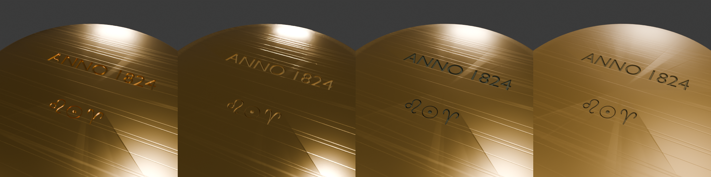

# Marble and brass presets

The armillary-v2 proof asset showed both presets at their weakest: the visual judge called the brass too new and gold, and the marble faint and crack-like. These renders show each preset before (`main` at 7464cf5) and after the change, on the same geometry, lights and seeds, rendered with Cycles on the GPU.

## Marble

**Target.** The new preset was tuned against two CC0 references:
- **ambientCG Marble012:** a polished white-grey veined marble. <https://ambientcg.com/view?id=Marble012>
- **Poly Haven Marble 01:** a cream marble with subtle veining, photographed 1.5 m wide. <https://polyhaven.com/a/marble_01>

Both show the same structure:
- soft-edged grey veins in layers, from broad faint drifts to sharper main veins;
- fine veinlets that branch off the main veins;
- vein widths from under a millimetre to about a centimetre, spaced a few centimetres apart on a slab.

**Before.** The old preset drew ridged bands from a warped linear field. Seen up close, that gives isolated hard-edged lines on a nearly uniform wash.

**After.** The new preset draws veins as isolines of warped noise:
- a main family whose width and darkness wander along its length;
- a weaker second family;
- veinlets near the main veins;
- grey smoke and drifts around them.

At `scale` 1 these sizes are in metres; `DESIGN.md` lists the parameters.

**Measured.** `bridge/tests/marble_stats.py` bakes the base colour of a 0.5 m slab at 512 px (about 1 mm per pixel) and reads the vein mask:
- **Depth:** how far a pixel is darker than the light stone, scaled from the 80th percentile (0) to the 1st (1).
- **Core:** pixels with a depth of at least 0.5.
- **Softness:** pixels with a depth between 0.15 and 0.5, divided by the core pixels. A hard line has almost no such pixels; a vein with a halo has several for each core pixel.
- **Width:** the shorter of the horizontal and vertical run through each core pixel, in millimetres.

| Swatch | Softness | Width p10 / p50 / p90 (mm) |
|---|---|---|
| marble before, seeds 1, 2, 3 | 2.18, 1.26, 2.27 | 10.7 / 15.6 / 22.5, 24.4 / 41.0 / 56.6, 7.8 / 32.2 / 45.9 |
| marble after, seeds 1, 2, 3 | 6.77, 8.03, 9.89 | 1.0 / 4.9 / 13.7, 1.0 / 4.9 / 12.7, 1.0 / 3.9 / 10.7 |
| stone with voronoi cracks, cell scale 8 | 2.18 | 6.8 / 9.8 / 26.4 |

`test_marble.py` requires:
- **Soft edges:** a softness of at least 4 for marble, and at most 2.5 for cracked stone. Both limits leave a margin of about 1.7 to the measured values.
- **Layered, plausible widths:**
  - median width between 2 and 8 mm, as for the main veins of a Carrara slab;
  - a 90th to 10th percentile ratio of at least 6, which a single class of lines does not reach.

## Brass

The after strip shows `age` new, handled, aged and dull, from left to right.

**Before.** The old default was bright, saturated gold. Its edge mask also brightened engraved letters, so they read as lighter than the plate.

**Measured.** `age` drives an ambient-occlusion grime mask with a 3 mm reach. In `test_brass_ageing.py` a 6 cm plate has "808" cut 0.6 mm deep. The test bakes its base colour at 1024 px and compares the mean albedo of the cut floors with the open plate away from the letters:

| age | recess / open |
|---|---|
| new | 1.00 |
| handled | 0.73 |
| aged | 0.46 |
| dull | 0.70 |

**Why aged is darkest.** The strokes are about 1.4 mm wide and 0.6 mm deep. From the middle of such a slot, about half of the hemisphere is hidden. That is far past the occlusion at which the mask is full (0.25), so aged grime darkens most of the floor towards the patina colour and the ratio drops below 0.5; the texels next to the walls, which the bake samples at the very edge of the mask, keep it above the patina-to-brass ratio of about 0.2. New brass has no grime and no patina, so its recesses keep the brass colour (ratio at least 0.9).
