# Marble and brass presets

The armillary-v2 proof asset showed both presets at their weakest: the visual judge called the brass too new and gold, and the marble faint and crack-like. These renders show each preset before (`main` at 7464cf5) and after the change, on the same geometry, lights and seeds, rendered with Cycles on the GPU.

## Marble

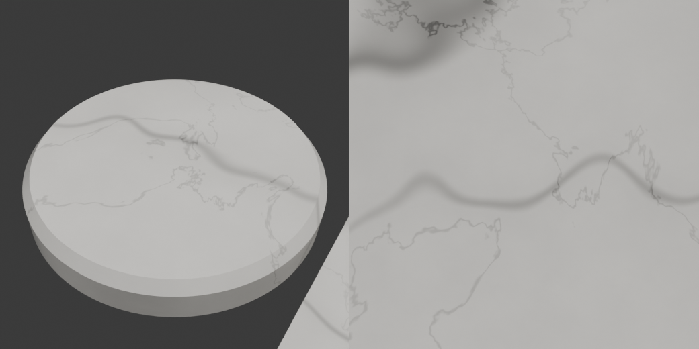
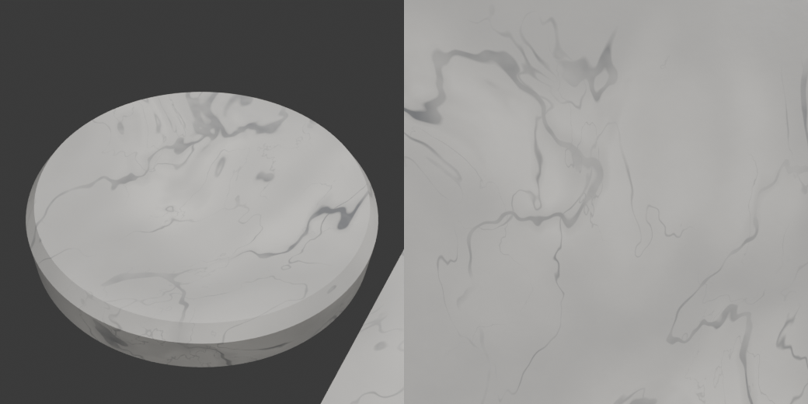

**Target.** The new preset was tuned against two CC0 references:
- **ambientCG Marble012:** a polished white-grey veined marble. <https://ambientcg.com/view?id=Marble012>
- **Poly Haven Marble 01:** a cream marble with subtle veining, photographed 1.5 m wide. <https://polyhaven.com/a/marble_01>

Both show the same structure:
- soft-edged grey veins in layers, from broad faint drifts to sharper main veins;
- fine veinlets that branch off the main veins;
- vein widths from under a millimetre to about a centimetre, spaced a few centimetres apart on a slab.

**Before.** The old preset drew ridged bands from a warped linear field. Seen up close, that gives isolated hard-edged lines on a nearly uniform wash.

**After.** The new preset draws veins as isolines of warped noise:
- a main family whose width and darkness wander along its length;
- a weaker second family;
- veinlets near the main veins;
- grey smoke and drifts around them.

At `scale` 1 these sizes are in metres; `DESIGN.md` lists the parameters.

**Measured.** `bridge/tests/marble_stats.py` bakes the base colour of a 0.5 m slab at 512 px (about 1 mm per pixel) and reads the vein mask:
- **Depth:** how far a pixel is darker than the light stone, scaled from the 80th percentile (0) to the 1st (1).
- **Core:** pixels with a depth of at least 0.5.
- **Softness:** pixels with a depth between 0.15 and 0.5, divided by the core pixels. A hard line has almost no such pixels; a vein with a halo has several for each core pixel.
- **Width:** the shorter of the horizontal and vertical run through each core pixel, in millimetres.

| Swatch | Softness | Width p10 / p50 / p90 (mm) |
|---|---|---|
| marble before, seeds 1, 2, 3 | 2.18, 1.26, 2.27 | 10.7 / 15.6 / 22.5, 24.4 / 41.0 / 56.6, 7.8 / 32.2 / 45.9 |
| marble after, seeds 1, 2, 3 | 6.77, 8.03, 9.89 | 1.0 / 4.9 / 13.7, 1.0 / 4.9 / 12.7, 1.0 / 3.9 / 10.7 |
| stone with voronoi cracks, cell scale 8 | 2.18 | 6.8 / 9.8 / 26.4 |

`test_marble.py` requires:
- **Soft edges:** a softness of at least 4 for marble, and at most 2.5 for cracked stone. Both limits leave a margin of about 1.7 to the measured values.
- **Layered, plausible widths:**
  - median width between 2 and 8 mm, as for the main veins of a Carrara slab;
  - a 90th to 10th percentile ratio of at least 6, which a single class of lines does not reach.

## Brass

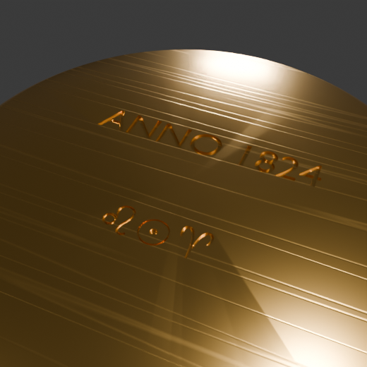

The after strip shows `age` new, handled, aged and dull, from left to right.

**Before.** The old default was bright, saturated gold. Its edge mask also brightened engraved letters, so they read as lighter than the plate.

**Measured.** `age` drives an ambient-occlusion grime mask with a 3 mm reach. In `test_brass_ageing.py` a 6 cm plate has "808" cut 0.6 mm deep. The test bakes its base colour at 1024 px and compares the mean albedo of the cut floors with the open plate away from the letters:

| age | recess / open |
|---|---|
| new | 1.00 |
| handled | 0.73 |
| aged | 0.46 |
| dull | 0.70 |

**Why aged is darkest.** The strokes are about 1.4 mm wide and 0.6 mm deep. From the middle of such a slot, about half of the hemisphere is hidden. That is far past the occlusion at which the mask is full (0.25), so aged grime darkens most of the floor towards the patina colour and the ratio drops below 0.5; the texels next to the walls, which the bake samples at the very edge of the mask, keep it above the patina-to-brass ratio of about 0.2. New brass has no grime and no patina, so its recesses keep the brass colour (ratio at least 0.9).

# Natural presets, layer masks and soft stone

The `natural-materials` job added six presets (`bark`, `moss`, `leaf`, `soil`, `sand`, `grass_ground`), four `material_layer` masks (`slope`, `height`, `up_facing`, `attribute`) and fixed the polygon patches of `stone`. `render_natural.py` renders the images on this page with Blendworks commands only: `blender --background --factory-startup --python docs/materials/render_natural.py -- docs/materials`.

## Stone without patches

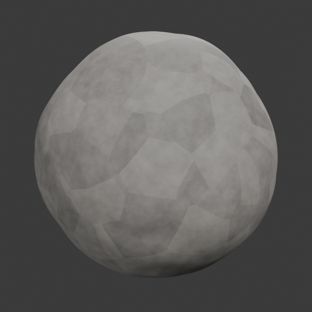
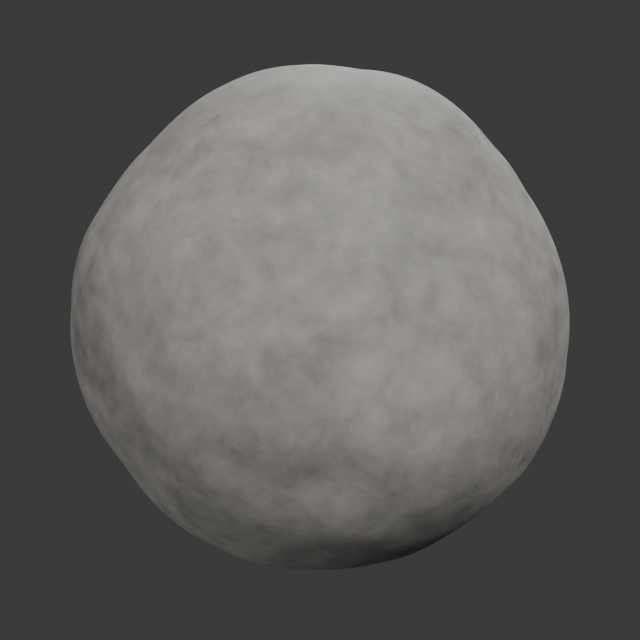

**Before** (`main` at 7a34a89, now `hard_cells: true`): hard-edged polygons of flat colour on a curved boulder, which reads as camouflage.

**Root cause.** The colour patches came from the `Color` output of a Voronoi texture. That output is a random colour that is constant inside each cell, so it jumps at every cell border, however the surface bends. The distance metric, the mapping and any threshold were not at fault: the discontinuity is in the output itself. The cracks (`cracks`) use the separate distance-to-edge output and are unchanged.

**After.** The patches are two domain-warped fBm noise fields (`cell_scale` and 3.1 times that frequency), which are continuous, so every boundary is soft at any setting. `hard_cells: true` asks for the old flat cells.

**Measured.** `bridge/tests/natural_stats.py` bakes the base colour of a 1 m sphere at 512 px and looks at the luminance along each row of the equator band. A boundary pixel has a step of more than 0.02 between the pixels three to either side. It is hard when a single one-pixel step makes up at least 70% of that step, which means the whole step happens within one pixel:

| Stone | Hard share of boundary pixels | Boundary pixels |
|---|---|---|
| new default (`hard_cells` false) | 0.04 | 14,530 |
| `hard_cells` true (the old patches) | 0.56 | 16,818 |

`test_natural_materials.py` requires at most 0.12 for the default and at least 0.4 for `hard_cells`, with at least 2,000 boundary pixels in both so that a stone without any patches cannot pass. The limits leave a margin of 0.08 and 0.16 to the measured values. The fine grain of the stone is in both and adds one-pixel steps, which is why the hard share is 0.56 and not close to 1.

## Natural presets

All sizes are in metres at `scale` 1. Base-colour luminance coefficient of variation over a 1 m patch at 256 px (`test_natural_presets_vary_like_scans_over_one_metre` requires at least 0.15; scans measure 0.25 to 0.40, `docs/research/natural-shapes.md` 2.6):

| Preset | CV | Render |
|---|---|---|
| `bark` (grain along y) | 0.20 | 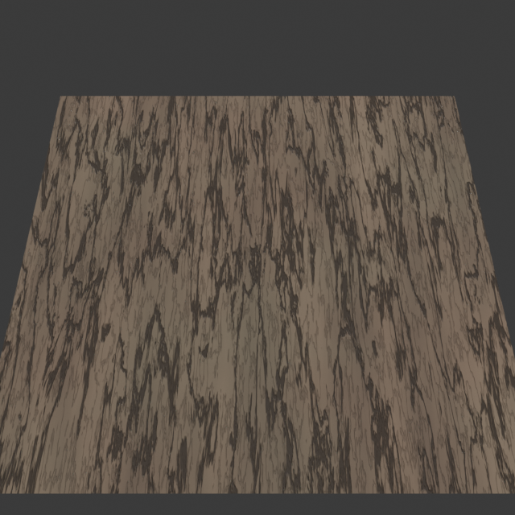 |
| `moss` | 0.23 | 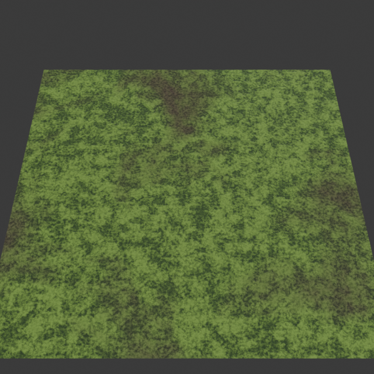 |
| `leaf` | 0.20 | 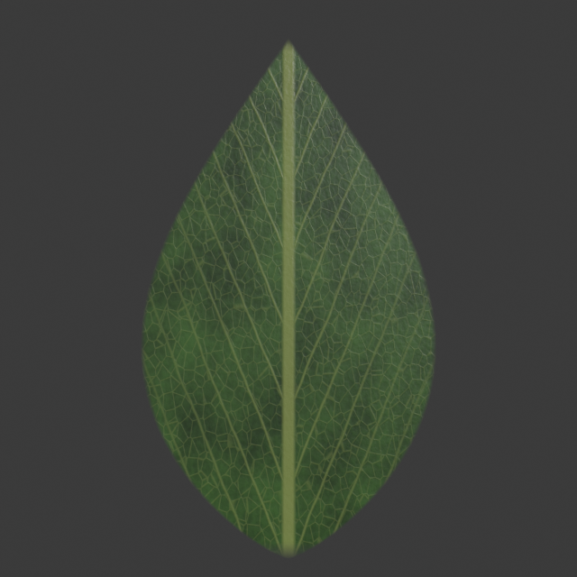 |
| `soil` | 0.20 | 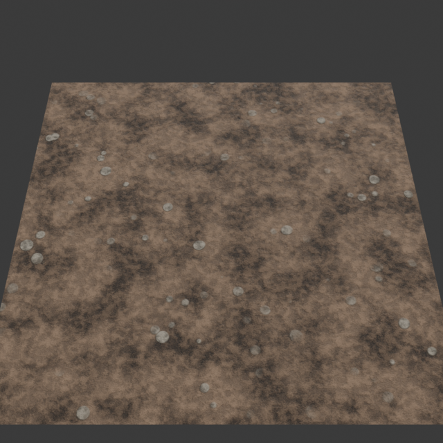 |
| `sand` | 0.18 | 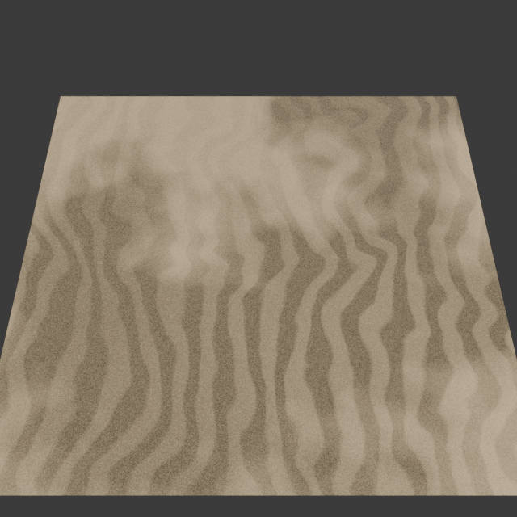 |
| `grass_ground` | 0.23 | 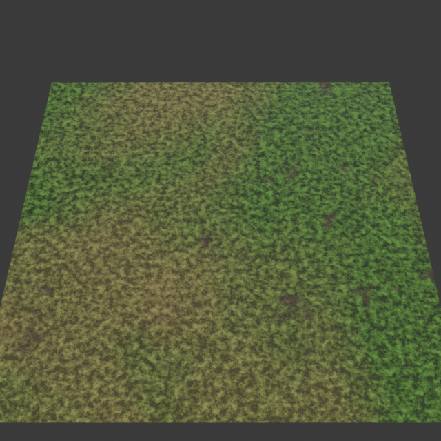 |

**Targets.** The presets were tuned against the structure the following CC0 assets show, not matched pixel by pixel; nothing from them is committed (the listings were checked through the Poly Haven API, the images were not downloaded):
- **bark:** Poly Haven Bark Brown 02, <https://polyhaven.com/a/bark_brown_02>: plates a few centimetres wide split by deep fissures that run along the trunk.
- **moss:** Poly Haven Rock Moss Set 01, <https://polyhaven.com/a/rock_moss_set_01>: tufts of bright tips over darker undergrowth, in patches on the tops of rocks.
- **leaf:** Poly Haven Searsia Lucida, <https://polyhaven.com/a/searsia_lucida>: a pointed blade with a pale midrib, pairs of lateral veins and a fine net.
- **soil:** Poly Haven Brown Mud Leaves 01, <https://polyhaven.com/a/brown_mud_leaves_01>: dark crumbs and clods with pale pebbles.
- **sand:** Poly Haven Coast Sand 01, <https://polyhaven.com/a/coast_sand_01> and Aerial Beach 01, <https://polyhaven.com/a/aerial_beach_01>: fine grain, dark flecks and wind ripples.
- **grass_ground:** Poly Haven Aerial Grass Rock, <https://polyhaven.com/a/aerial_grass_rock>: green and dry tufts over bare soil.

**How each is built.**
- **`bark`:** a warped, ridged noise (isolines of `|n - 0.5|`) in coordinates squeezed along the grain axis, so the fissures stretch along it, plus finer cracks, plate tone and a pale lichen tint. `fissure_spacing` is the noise wavelength in metres; `fissure_depth` sets both the width of the fissures and the depth of the bump.
- **`moss`:** `patchiness` shifts a threshold on a broad noise, so 0 covers everything and 1 leaves mostly bare ground; `clump_size` is the tuft size and `height` scales the relief.
- **`leaf`:** a midrib and lateral veins laid out on one unit square (the UV square by default), a Voronoi vein net and blotches. `cutout` cuts a pointed outline into the alpha, `alpha` scales the opacity, `translucency` is the transmission weight. These two channels go to the Principled BSDF only; `material_layer` blends colour, roughness, metallic and bump.
- **`soil`:** crumbs and clods at `clod_size`, pebbles of varying size; `moisture` darkens and smooths.
- **`sand`:** grain, dark flecks and ripples from a warped wave texture whose strength varies; `ripple_spacing`, `ripple_direction`, `moisture`.
- **`grass_ground`:** `tuft_size` clumps of fine blades, dry patches by `dryness`, bare soil by `density`.

## Layer masks

`material_layer` takes `mask` and more in `with_masks`, combined by `combine`: `all` (product) or `any` (maximum).

| Mask | Settings | Behaviour |
|---|---|---|
| `slope` | `angle_min`, `angle_max`, `angle_edge` (degrees, default 5) | The angle between the world up direction and the surface normal: 0 on flat ground facing up, 90 on a vertical wall. 0 outside the limits, 1 inside beyond the soft edge. |
| `height` | `z_min`, `z_max`, `z_edge` (metres, default 0.5) | World z. 0 below `z_min`, 1 above it beyond the edge. |
| `up_facing` | `strength` (0 to 1, default 0.5) | A smoothstep of the normal's z component: 1 facing up, 0 where it points down or sideways; `strength` is how far down the slopes it reaches. |
| `attribute` | `attribute`, `value_min`, `value_max` | The named float point attribute (`slope`, `height` or `curvature` from `heightfield` and `noise_displace`) mapped linearly from `value_min` to `value_max`. |

The soft edges lie inside the limits, so 1 is reached `angle_edge` or `z_edge` past the limit. `amount`, `softness` and `breakup` belong to the noise, edges, cavity and vertex colour masks; the four new masks set their own edges. `invert` flips every mask.

`docs/examples/natural_dressing.py` dresses the terrain and rock of `noise_terrain.py` with these: soil, moss in noise patches on up-facing, gentle slopes, a stone without patches, a bark log and a leaf card.
