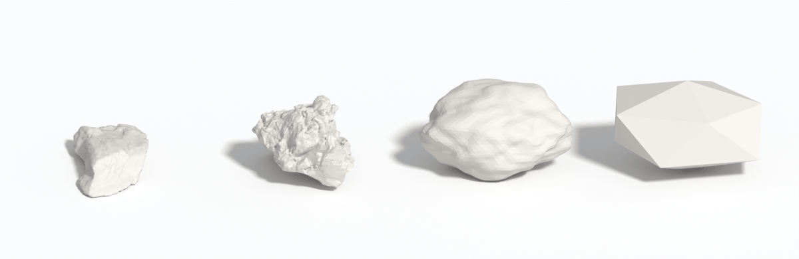
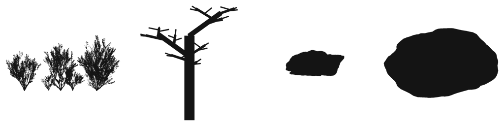
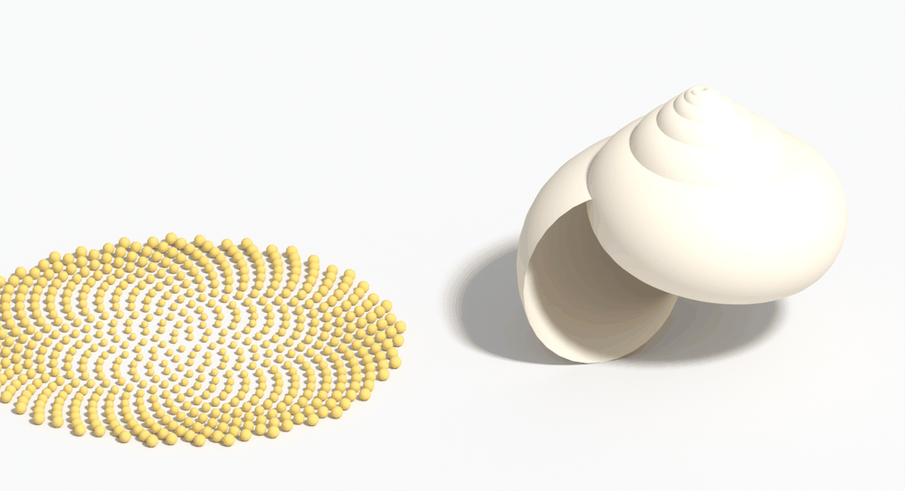

# Natural shapes: research and plan

Blendworks builds hard-surface assets well. Trees, plants, rocks, terrain and shells are its weak side. This report surveys how the state of the art makes natural shapes believable, measures what separates real scans from simple procedural stand-ins, finds the gaps in the Blendworks bridge and judge, and turns the findings into a prioritised plan of commands, presets and judge rules.

Read it like this:

- `[Sn]` links to a source in the list at the end. Every source was opened while writing, and the claim was checked against the text that was available. Where only an abstract, a summary or a secondary source could be read, the text says so.
- **Not verified** marks a claim that could not be confirmed against a source. It is my judgement or an assumption, and it needs checking before a spec relies on it.
- `[M]` marks a number measured for this report on CC0 scans and on stand-ins built from primitives (section 2.7). Those measurements are a small sample. They can set first thresholds, but they are not final ones.
- Repository paths such as `bridge/blendworks_bridge/commands/wear.py` refer to `main` at `10942d8`.

## Contents

1. [Survey of methods](#1-survey-of-methods)
2. [What makes it read as natural](#2-what-makes-it-read-as-natural)
3. [Gap analysis against Blendworks](#3-gap-analysis-against-blendworks)
4. [Plan](#4-plan)
5. [Judge rules for natural assets](#5-judge-rules-for-natural-assets)
6. [Licences](#6-licences)
7. [Sources](#7-sources)

## 1. Survey of methods

### 1.1 Growth and branching

**L-systems.** *The Algorithmic Beauty of Plants* (Prusinkiewicz and Lindenmayer) is the reference text, and it is free as a PDF [S1]. It covers bracketed L-systems for branching (section 1.6.3), stochastic L-systems for variation between plants of one species (1.7), parametric L-systems (1.10), trees (chapter 2), phyllotaxis (chapter 4) and compound leaves (5.3) [S1]. A bracketed L-system rewrites a string of modules in parallel, and a turtle draws it, so `[` and `]` push and pop the turtle state to start and end a branch [S1, section 1.6.3]. One tree model in the book shrinks each daughter segment's width by `wr = 0.707`. The book derives that value from Leonardo da Vinci's postulate: when one branch of diameter `w1` splits into two of equal diameter `w2`, then `w1² = 2·w2²` [S1, page 57]. The book uses a divergence angle of 137.5° between successive lateral organs in several plant models [S1, chapters 1 to 4].

**Space colonisation.** Runions, Lane and Prusinkiewicz (2007) grow a tree skeleton towards attraction points scattered inside a crown envelope [S2]. They describe each step as follows:
- An attraction point influences only the tree node nearest to it, and only within the radius of influence `di`.
- A node with influencing points grows a new node at distance `D`. Its direction is the normalised sum of the unit vectors towards those points.
- An optional tropism vector `g` can bias that direction.
- A point is removed when a node comes closer than the kill distance `dk`.

The parameters read like crown properties. Fewer points (`N`) and a larger `dk` give sparser crowns, and a small `di` gives wiggly, gnarly branches. The figures use values such as `N = 12000, dk = 2D` and `di = 8D` or `17D`. Branch radii follow the pipe model: `r^n = r1^n + r2^n` at each branching point, computed from the tips down, with `n` "usually between 2 and 3". The limbs are generalised cylinders oriented by a parallel transport frame [S2].

**Weber–Penn.** Weber and Penn (SIGGRAPH 1995) describe a parametric tree model in recursive levels of stems [S3]:
- `Shape` picks a crown profile from a table: conical, spherical, hemispherical, cylindrical, tapered cylindrical, flame, inverse conical, tend flame, or a pruning envelope.
- Child stems are spaced by `nRotate` and angled by `nDownAngle`.
- A child's radius is `radius_parent × (length_child / length_parent)^RatioPower`.
- `nTaper`, `Flare` and `Lobes` shape each stem, so a trunk can flare at its base and carry ribs.
- `Leaves` adds a last level of leaves.

The paper cites the Schimper–Braun divergence series of 180°, 120°, 144° and 135°. It reports that "any number near 140 degrees works well in most situations" [S3].

**Sapling Tree Gen.** Sapling is Blender's implementation of the Weber–Penn method. Its manual says so and lists its settings: geometry, branch radius, branch splitting, branch growth, pruning, leaves, armature and animation [S4]. It is now an extension on extensions.blender.org, licensed under "GNU General Public License v3.0 or later" [S5].

**Self-organising trees.** Palubicki et al. (SIGGRAPH 2009) model tree form as the emergent result of buds and branches competing for light or space, regulated by internal signals. The model can be steered with brushes, sketching, pruning and bending [S6].

**SpeedTree, The Grove, tree-gen:**
- **SpeedTree** is a commercial vegetation toolkit owned by Unity. Its modeler combines "procedural generators and manual art tools", and it is sold as subscriptions (Indie, Pro, Enterprise and a Library add-on) [S7].
- **The Grove** grows trees in Blender and Houdini with "a full simulation of the natural processes in living trees, which react to light and gravity". It has pruning tools, and it is a paid product: its preview is "for evaluation purposes only" [S8].
- **tree-gen** is a Blender add-on from an undergraduate dissertation, under GPL-3.0. Its README says models made with it may be used freely except for direct sale as assets [S9]. Its README does not name the algorithm, so this report does not attribute one to it.

### 1.2 Erosion and weathering

**Terrain erosion:**
- **Musgrave, Kolb and Mace (SIGGRAPH 1989)** introduced "a simple physical erosion model ... which simulates hydraulic and thermal erosion processes to create global stream/valley networks and talus slopes". The same paper varies fractal character with altitude to approximate eroded landscapes [S10]. Only the abstract could be read. The exact thermal rule (material moves downhill where the slope exceeds a talus angle) is the usual reading, but it is **not verified** against the paper's text.
- **Beneš and Forsbach (2002)** split hydraulic erosion into independent steps: water dissolves material, carries it, and deposits it when evaporation makes the sediment exceed the water's capacity [S11].
- **Mei, Decaudin and Hu (2007)** drive erosion with a shallow-water velocity field on the GPU, using the sediment capacity `C = Kc · sin(α) · |v|` from the local tilt `α` and the water speed `|v|` [S12].
- **Droplet erosion.** Sebastian Lague's MIT-licensed `Hydraulic-Erosion` simulates single droplets. Each droplet runs downhill over a heightmap, erodes up to its capacity, deposits when it slows or climbs, and evaporates [S13]. Its defaults make a good starting set: `inertia 0.05`, `sedimentCapacityFactor 4`, `minSedimentCapacity 0.01`, `erodeSpeed 0.3`, `depositSpeed 0.3`, `evaporateSpeed 0.01`, `gravity 4`, `erosionRadius 3` and `maxDropletLifetime 30` [S13].
- **Blender.** The A.N.T. Landscape add-on (GPL) has a "Landscape Eroder" for its landscape grids [S14].

**Rock shape:**
- **Fragments.** Domokos, Jerolmack, Kun and Török (PNAS 2020) argue that natural 3D rock fragments are cuboid on average, with mean face and vertex counts of `[6, 8]`. They measured 556 fragments from a weathering dolomite outcrop and found `[6.63, 8.93]`, within 12 % of the prediction. Their simulations point to generic binary breakup (a piece splitting in two, again and again) as the cause [S17].
- **Abrasion.** Domokos, Jerolmack, Sipos and Török (2014) show that pebble abrasion is a curvature-driven flow with two phases. First, edges round off without any change in the axis dimensions until the shape is fully convex. Then the axes shrink slowly while the pebble stays convex [S18].

Both papers give a procedural recipe in physical terms: fracture into blocky polyhedra, then round them by curvature.

**Voronoi and boolean fracture.** Blender's Cell Fracture add-on builds each cell from the bisector planes between a point and its neighbours. It starts from the bounding box and intersects the half-spaces with `mathutils.geometry.points_in_planes` [S15]. The source file's header is `GPL-2.0-or-later` [S15]. The extension listing says "GNU General Public License v3.0 or later" [S16]. A boolean shatter does the same with explicit cutter meshes. Blendworks already has an exact multi-cutter `boolean` (`bridge/blendworks_bridge/commands/modifiers.py`).

### 1.3 SDFs and implicit surfaces

- **Metaballs.** Blender's metaballs are implicit surfaces: "mathematical formulas that are calculated on-the-fly", which blend as they approach each other [S19]. A family shares one resolution and an *Influence Threshold*, the field level where the surface lies. Each element has its own *Stiffness* [S20].
- **Smooth union.** Inigo Quilez lists smooth-minimum functions for blending signed distances. Its parameter `k` is the blend width in distance units [S21]. The quadratic version is `h = max(k − |a − b|, 0) / k; smin = min(a, b) − h²·k/4`, after `k *= 4` [S21].
- **Remeshing.** The Remesh modifier's Voxel mode "uses an OpenVDB to generate a new manifold mesh from the current geometry while trying to preserve the mesh's original volume". *Adaptivity* lowers the face count where detail is not needed [S22]. Geometry Nodes can also turn a volume into a mesh at a threshold with *Volume to Mesh* [S23]. The Skin modifier turns vertices and edges with per-vertex radii into a mostly-quad surface, "a quick way to generate base meshes ... with arbitrary topology" [S24].
- **Judge limit.** The Blendworks judge cannot bound remesh or Geometry Nodes modifiers. It fails them with `unbounded_geometry`, so they must be applied before delivery (`docs/DESIGN.md`, section 4, Importer limits).

### 1.4 Noise stacks

- **Perlin noise and turbulence.** Perlin (SIGGRAPH 1985) introduced the noise function and built `turbulence(p)` as a sum of `abs(Noise(p / scale) · scale)` over halving scales [S25]. That absolute value is the root of the ridged and "billowy" variants. The same paper notes that superimposed linear wave fronts "form a self-replicating pattern when viewed over any reasonably large area" [S25]. This is an early statement of the repetition problem.
- **fBm and the Hurst exponent.** Quilez builds fBm by doubling the frequency each octave and multiplying the amplitude by a gain `G = 2^−H`, where `H` is the Hurst exponent between 0 (rough) and 1 (smooth) [S26]. He notes that `G = 0.5` (`H = 1`) is the common hardcoded choice. He argues that mountains suggest `G = 1/2`, because they scale isotropically [S26].
- **Measured roughness.** Gagnon, Lovejoy and Schertzer (2006) estimated `H = 0.46`, `0.66` and `0.77` for bathymetry, continents and continental margins [S30]. Earth topography is therefore rougher than `H = 1`. With `G = 2^−H`, those values give per-octave gains of about 0.73, 0.63 and 0.59 (my arithmetic).
- **Coastlines.** Mandelbrot (1967) read Richardson's coastline data as a fractal dimension: the west coast of Great Britain has `D = 1.25`, the Australian coast `1.13` and the South African coast `1.02` [S49].
- **Domain warping.** Quilez offsets the lookup point by another fBm, `fbm(p + 4·q)` with `q = (fbm(p), fbm(p + (5.2, 1.3)))`, and can repeat the step [S27]. This gives the folded and streaked look of rock strata and marble.
- **Worley noise.** Worley (SIGGRAPH 1996) defined `F1`, `F2` and `F3` as the distances to the nearest feature points of a random point field. He suggested `F2 − F1` for cell borders, and showed patterns that resemble "flagstone-like tiled areas, ... rock, mountain ranges, and craters" [S28].
- **In Blender.** The Noise Texture node offers fBM, Multifractal, Hybrid Multifractal, Ridged Multifractal and Hetero Terrain. Its inputs are Scale, Detail (octaves), Roughness, Lacunarity, Offset, Gain and Distortion. Ridged Multifractal "calculates the absolute value of the noise, creating 'canyons', and then flips the surface upside down" [S29]. The manual warns that noise sampled at whole multiples of `1/scale` always returns 0.5, and that a slightly tilted plane shows banding. Its fixes are an offset, another scale or rotated coordinates [S29]. That matters for scattering on a grid.
- **Assumption.** That Blender's Roughness acts as the per-octave gain `G` is an assumption, **not verified**.

**Real-world scale.** Parameters in metres, not in UV units, keep detail at a believable size:

| Noise layer | Choice | Reason |
|---|---|---|
| Terrain fBm | `H ≈ 0.7` (`G ≈ 0.6`), lacunarity 2 | the measured continental `H` [S30] |
| Rock surface | octaves until the smallest wavelength is about 2 texels of the target texture | Perlin stops at the pixel size so higher frequencies are clamped [S25] |
| Ridged layer | only where the brief needs crests | ridges come from `abs()` [S25, S29] |
| Warp | one level of `fbm(p + 4·q)` | strata and veins [S27] |

The starting values (`H ≈ 0.7` and the octave cut-off) are recommendations built on those sources, **not verified** as optimal.

### 1.5 Phyllotaxis, shells, differential growth, reaction–diffusion

**Phyllotaxis.** Vogel's formula places floret `n` of a sunflower head at angle `φ = n × 137.5°` and radius `r = c·√n` [S1, section 4.1]. Douady and Couder show with ferrofluid drops and a simulation that Fibonacci spirals self-organise from successive primordia that repel each other. One growth parameter, `G`, controls the pattern. It is equivalent to Richards' plastochrone ratio [S31]. The divergence angle they derive is `Φ = 2π(2 − τ) = 137.5°`, with `τ` the golden mean [S31].

**Shells:**
- **Raup.** Raup (1966) described coiled shells with a few parameters of a logarithmic spiral:
  - `W`, the growth of the shell radius per revolution;
  - `D`, the relative distance of the generating curve from the coiling axis;
  - `T`, the translation along the axis;
  - and the shape of the generating curve.

  Together they "fully describe a perfect logarithmic spiral" [S33]. Raup's paper itself (J. Paleont. 40, 1178) was not available. This summary comes from Hutchinson (1989), who cites it.
- **Fowler, Meinhardt and Prusinkiewicz (SIGGRAPH 1992).** They sweep a Bézier generating curve along a logarithmic helico-spiral. The angle grows arithmetically while the radius and the height grow geometrically, and the curve scales up as it turns [S32]. Pigmentation patterns come from Meinhardt's activator–inhibitor reaction–diffusion model [S32].

**Differential growth.** Nervous System's Floraform (2015) simulates a growing elastic surface as a triangle mesh [S34]:
- Edges are springs with a bending energy between faces, following Grinspun et al.'s *Discrete Shells*.
- Edges grow at rates set by the geodesic distance from a growth zone, computed with the heat method.
- An edge that passes a length threshold is split, and edges are flipped to keep the triangles well-shaped.
- Ellipsoid bodies on the vertices stop the surface from passing through itself.

This makes ruffled leaves, lettuce-like edges, coral and lichen.

**Reaction–diffusion:**
- **Gray–Scott.** Pearson (1993) simulated the Gray–Scott model `U̇ = Du∇²U − UV² + F(1 − U)` on a 2.5 × 2.5 periodic domain, with `Du = 2 × 10⁻⁵`, `Dv = 10⁻⁵`, a 256 × 256 grid and time step 1. He found self-replicating spots and other irregular patterns. One example is `F = 0.02, k = 0.059`, evolved for 20,000 steps [S35].
- **On surfaces.** Turk (SIGGRAPH 1991) textured models "by simulating a reaction-diffusion process on the surface of the model" [S36].

Uses for Blendworks: shell pigment, leopard-like spots on organic forms, coral surfaces, and baked masks for moss or lichen.

### 1.6 Scattering and ecosystems

- **Poisson disk sampling.** Bridson (2007) generates Poisson disk samples in `O(N)` in any dimension [S37]. A background grid with cell size `r/√n` holds at most one sample per cell. From a random active sample, up to `k` candidates (typically 30) are drawn in the annulus between `r` and `2r`. A candidate farther than `r` from every sample is accepted, and after `k` failures the sample leaves the active list [S37].
- **In Blender.** The *Distribute Points on Faces* node has a Poisson Disk mode with *Distance Min* and *Density Max* (points per square metre). A *Density* input scales the density per face and can come from an attribute such as a slope mask [S38]. Its points carry a stable `id`, normal and rotation for *Instance on Points* [S38]. *Realize Instances* turns instances into real geometry, at a cost in performance when there are many [S40].
- **Ecosystems.** Deussen et al. (SIGGRAPH 1998) model scenes with thousands of plants: terrain, plant distribution (including ecosystem simulation), individual plant geometry, and approximate instancing to render them [S39].
- **Size distributions.** Enquist and Niklas (2001) found that in tree-dominated communities "the number of individuals scales as the −2 power of basal stem diameter", except at the highest latitudes [S52]. A forest scatter that draws trunk sizes this way has the size structure of a real community.

Density by slope and height is the usual mask (rocks on steep ground, grass on flat ground, snow up high). It is a convention, and no single primary source sets it. The thresholds in the plan are therefore parameters, not claims.

### 1.7 Blender specifics

| Tool | What it does | Licence | Blendworks use |
|---|---|---|---|
| Geometry Nodes | node-based geometry on a modifier [S41] | Blender, GPL [S44] | the judge refuses unapplied GN (`unbounded_geometry`), so apply before export |
| Displace modifier | moves vertices by a texture along normal, XYZ or RGB-to-XYZ [S42] | Blender | exposed through `add_modifier` with legacy textures only |
| Remesh (voxel) | OpenVDB manifold remesh that keeps volume [S22] | Blender | not exposed |
| Skin modifier | radius-per-vertex skeleton to surface [S24] | Blender | not exposed |
| Metaballs | implicit blobs [S19, S20] | Blender | not exposed |
| Sapling Tree Gen | Weber–Penn trees [S4] | GPL-3.0-or-later [S5] | reference only; do not copy code |
| Ivy Gen | grows ivy on a mesh from the 3D cursor, "based on the wonderful code by Thomas Luft and his original IvyGen program" [S43] | GPL [S43] | reference only |
| Cell Fracture | Voronoi cells by bisector planes [S15] | GPL-2.0-or-later (source), GPL-3.0-or-later (extension) [S15, S16] | reference only |
| A.N.T. Landscape | noise landscapes and an eroder [S14] | GPL [S14] | reference only |

Blender says scripts that use its Python API must, if published, be shared under a GPL-compliant licence. It also says that what you create with Blender is your sole property [S44]. Section 6 draws the consequences.

### 1.8 Photogrammetry and scan libraries

| Library | Licence | Use for Blendworks |
|---|---|---|
| Poly Haven | CC0. "You can use our assets for any purpose", redistribution allowed, no credit needed. Site text, logos and renders are not CC0, and scraping needs permission [S45] | already in Blendworks (`library_*`, DESIGN section 6); calibration set for judge rules; kitbash source |
| ambientCG | "All ambientCG assets are provided under the Creative Commons CC0 1.0 Universal License"; no credit required [S46] | textures and calibration; a second CC0 source |
| Quixel Megascans (Fab) | Fab sells under its Standard licence, with Personal and Professional tiers by revenue below or above USD 100,000, or under CC-BY [S47]. Epic said in 2024 that most Megascans would stop being free in 2025 [S48] | reference viewing only, until a hirer's own licence covers it. Whether the Standard licence allows redistribution inside a delivered asset is **not verified** |

Scans are a reference and a source, but not drop-in assets:
- **Open shells [M].** Three of the ten rock objects measured here are open: `coast_rocks_05` has 1,113 boundary edges, `namaqualand_boulder_02` 396 and one rock of `rock_moss_set_01` 18, counted after merging vertices closer than 1 µm. The two large scans are open where they met the ground. They would fail `manifold: true` as they are.
- **Triangle counts [M].** Several run from 66k to 772k triangles at the 1k download.
- **The scan route.** A scan route needs closing (voxel remesh), decimation, UV and bake, and Blendworks has all of these except the remesh.

## 2. What makes it read as natural

Each property below has a source. Where a threshold comes from my measurements, it says so.

### 2.1 Fractal dimension and self-similarity

- **Coastlines.** Natural outlines have non-integer dimensions. Mandelbrot's coastlines range from `D = 1.02` (South Africa) to `1.25` (west of Britain) [S49].
- **Preferred range.** Taylor, Newell, Spehar and Clifford report "a consistent aesthetic preference for images with a fractal dimension in the range 1.3 to 1.5". This held across natural scenes, mathematical fractals and Pollock paintings, with lower preference at 1.1–1.2 and at 1.6–1.9. Their natural-scene stimuli ranged from `D = 1.1` to `1.9` [S50].
- **Measured [M].** I measured box-counting dimensions of silhouette outlines rendered in Blender (section 2.7):

| Asset | Box-counting `D` of the silhouette edge |
|---|---|
| CC0 shrub scan (`searsia_lucida`) | 1.54–1.65 |
| tree built from 40 cylinders | 1.10–1.12 |
| real rock silhouettes | 0.96–1.01 |
| sphere, displaced and faceted stand-ins | 0.95–0.98 |

Silhouette dimension separates foliage from primitive trees. It does not separate rocks from rock stand-ins at 1024 px, because a rock's outline is smooth at that scale.

### 2.2 Size distributions

- **Fragments.** Turcotte (1986) shows that fragmentation is "a scale invariant process": fragments from weathering, explosions and impacts follow a fractal number–size distribution, and "the fractal dimension is a measure of the fragility of the fragmented material" [S51]. A rock set, scree or a rubble scatter should therefore follow a power law, with many small pieces and few large ones, not uniform sizes. The exact `D` values Turcotte tabulates were not available (**not verified**).
- **Trees.** Tree counts fall as the −2 power of stem diameter [S52].

### 2.3 Allometry

- **Leonardo's rule.** Leonardo's rule keeps the cross-section area through a branching: `d^Δ = Σ d_i^Δ` with `Δ = 2` [S53]. Eloy reports that the available data put the exponent in `1.8 < Δ < 2.3` "for a large number of species". He also notes that the rule "is routinely used in computer-generated trees" [S53].
- **In models.** The pipe model in space colonisation is the same relation with `n` between 2 and 3 [S2]. *The Algorithmic Beauty of Plants* uses `wr = 1/√2` for two equal daughters [S1, page 57].
- **In Weber–Penn.** A child's radius scales with `(length_child / length_parent)^RatioPower` [S3].

### 2.4 Curvature distributions

- **Shape index.** Koenderink and van Doorn's shape index maps each surface point to one number in `[−1, 1]`. The bands, as documented in scikit-image (which cites them), are: spherical cup, trough, rut, saddle rut, saddle, saddle ridge, ridge, dome and spherical cap, split at ±1/8, ±3/8, ±5/8 and ±7/8 [S54]. A sphere is all "spherical cap". A real rock mixes domes, ridges, saddles and ruts.
- **Abrasion.** Rounding is curvature-driven: edges with high curvature wear first, until the shape is convex [S18]. Fresh fragments are angular polyhedra with about 6 faces and 8 vertices [S17]. A believable rock is either blocky and fresh, or rounded with its large faces kept. A displaced sphere is neither.
- **Measured [M].** I measured a curvature proxy, explained in section 2.7: the angle between each face normal and the mean normal within a radius of 1/32 of the object's size. The sphere gives a 90th percentile of 2.9°, the clouds-displaced ico sphere 10.1° and the faceted ico sphere 13.9°. Ten single real rock objects range from 17.2° to 67.4°. The share of nearly flat samples (under 3°) is at most 0.172 in the real rocks, and at least 0.232 in the stand-ins.

### 2.5 Silhouette irregularity, with no visible repetition or tiling

- **Solidity [M].** Solidity is a silhouette's area divided by the area of its convex hull, and it measures concavity at the outline.

| Asset | Lowest solidity over front, right and top |
|---|---|
| sphere | 1.000 |
| displaced ico sphere | 0.987 |
| faceted ico sphere | 1.000 |
| the four single real rock objects | 0.739–0.936 |

- **Repetition.** Repetition is the clearest sign of fake natural content:
  - Perlin named it for wave fronts [S25].
  - Cohen et al. tile the plane "non-periodically" with a small set of Wang tiles, so large textured areas can be made without a periodic pattern [S55].
  - Blender's manual shows how a grid of samples gives constant values and banding [S29].
- **Measured repetition [M].** I measured repetition as the highest normalised autocorrelation of an image, away from zero shift (section 2.7):

| Image | Peak |
|---|---|
| exactly tiled textures | 1.000 |
| untiled scan textures | 0.094–0.489 |
| jittered grid of points (jitter 0.2) | 0.333 |
| Poisson disk points | 0.136 |

### 2.6 Material variation

Natural albedo varies at every scale. For rock textures this is what the measurements show [M]:

| Texture | Luminance coefficient of variation (CV) |
|---|---|
| Rock scan base colours | 0.25–0.40 |
| Bark scan | 0.33 |
| Leaf texture | 0.25 |

The CV is the standard deviation over the mean, over the used texels. A constant-colour material has a CV of 0. A rule can catch flat colour. A good lower bound needs measurements on more scan types (**not verified** beyond these six assets). Repetition (2.5) is the other half of material realism.

### 2.7 Measurements on reference assets

Seven CC0 models were downloaded from Poly Haven through its public API at the 1k glTF level:
- the rocks `rock_09`, `boulder_01`, `namaqualand_boulder_02`, `coast_rocks_05` and `rock_moss_set_01` (six rocks);
- `dead_tree_trunk_02`, a fallen log;
- `searsia_lucida`, three shrubs.

Each asset is at `https://polyhaven.com/a/<id>`, and Poly Haven's licence is CC0 [S45]. Four stand-ins were built from primitives the way Blendworks could build them today:
- a UV sphere;
- an ico sphere (5 subdivisions) displaced by a Clouds texture of size 0.4 and strength 0.25, scaled `(1, 0.8, 0.6)`;
- an ico sphere (1 subdivision) with its vertices jittered by ±15 %, scaled `(1, 0.75, 0.55)`;
- a three-level tree of 40 cylinders.

Everything ran in headless Blender 5.2.3:
- **Silhouettes:** Workbench, flat light, no anti-aliasing, a 1024 px orthographic view from the front, right and top, inside where alpha > 0.5.
- **Box-counting dimension:** the fitted slope of the occupied-box count against the box size, over boxes of 2 to 64 px on the 4-connected edge pixels.
- **Solidity:** mask area over the area of the convex hull of the edge pixels.
- **Curvature proxy:** 4,000 area-weighted face samples per object. For each sample, the angle between its normal and the area-weighted mean normal of the faces within a radius of 1/32 of the object's longest side. Coarse meshes were first subdivided without smoothing to at least 20,000 faces, so that the radius covers many faces.
- **Albedo CV:** over texels with luminance > 0.02, which leaves out unused atlas space.
- **Repetition:** a zero-padded autocorrelation of luminance, normalised by the overlap. Only shifts more than 16 px from zero and with at least 25 % overlap count.

The raw numbers are in `natural-shapes/measurements.json` and `natural-shapes/repetition.json`.

| Asset | Objects | Box dimension (3 views) | Lowest solidity | Normal deviation p50 / p90 (°) | Flat share | Albedo CV |
|---|---|---|---|---|---|---|
| rock_09 (scan) | 1 | 0.97–0.99 | 0.936 | 12.8 / 40.0 | 0.107 | 0.27 |
| boulder_01 (scan) | 1 | 0.96–1.01 | 0.922 | 22.6 / 55.5 | 0.097 | 0.25 |
| namaqualand_boulder_02 (scan) | 1 | 0.98–0.99 | 0.840 | 22.4 / 67.2 | 0.029 | 0.34 |
| coast_rocks_05 (scan) | 1 | 0.97–1.00 | 0.739 | 28.7 / 67.4 | 0.013 | 0.40 |
| rock_moss_set_01 (scan, 6 rocks) | 6 | 0.96–0.98 | 0.466 (set) | 7.3–12.6 / 17.2–30.8 | 0.053–0.172 | 0.28 |
| dead_tree_trunk_02 (scan, log) | 1 | 1.03–1.11 | 0.537 | 25.8 / 69.7 | 0.024 | 0.33 |
| searsia_lucida (scan, 3 shrubs) | 7 | 1.54–1.65 | 0.335 | n/a | n/a | 0.25 |
| UV sphere | 1 | 0.96 | 1.000 | 2.2 / 2.9 | 0.956 | n/a |
| displaced ico sphere | 1 | 0.95–0.97 | 0.987 | 5.0 / 10.1 | 0.232 | n/a |
| faceted ico sphere | 1 | 0.97–0.98 | 1.000 | 0.0 / 13.9 | 0.689 | n/a |
| cylinder tree | 40 | 1.10–1.12 | 0.185 | n/a | n/a | n/a |

The sample is small: 10 rock objects, 1 shrub set and 4 stand-ins. Every threshold built on it in section 5 is a starting value for calibration, not a final one.

*Figure 1. From left: `rock_09` and `boulder_01` (Poly Haven, CC0), an ico sphere displaced by Clouds, and a jittered 20-face ico sphere. All are scaled to a 1 m longest side and rendered in Blender 5.2.3 with Cycles (CPU, 64 samples, denoised), one sun and one clay material. The scan materials were removed. Pillow reduced the image to 1200 px and 256 colours.*

*Figure 2. The measurement silhouettes (Workbench, 1024 px, orthographic front view) of `searsia_lucida` (box dimension 1.65), the 40-cylinder tree (1.10), `rock_09` (0.995) and the displaced ico sphere (0.954). Each is reduced to 256 px and set side by side with Pillow.*

## 3. Gap analysis against Blendworks

The bridge has 29 command modules (`bridge/blendworks_bridge/commands/`) and nine material presets (`bridge/blendworks_bridge/presets.py`, with `brass.py` and `marble.py`). The judge rules are in `docs/DESIGN.md` sections 3 and 4 and in `src/judge/`. These are what the natural assets would use today:

- **Base shapes:** `add_primitive`, plus `subdivide` with 1 to 10 cuts and optional smoothing.
- **Displacement:** `add_modifier` displace, with only the legacy textures `clouds`, `voronoi`, `distorted_noise`, `stucci`, `marble`, `wood` and `musgrave`. Each takes only `size`, `depth`, `intensity` and `contrast` (`bridge/blendworks_bridge/modifier_specs.py`), so there is no fBm `H`, lacunarity, ridged offset or warp. There is also `displace_noise` (`jitter` or `dents`, `bridge/blendworks_bridge/commands/wear.py`).
- **Profile shapes:** `sweep` (linear `scale_start` to `scale_end`, `twist`, analytic `circle`, `arc` and `helix` paths), `loft` and `lathe` (`bridge/blendworks_bridge/commands/shapes.py`).
- **Curves:** `curve_from_points`, with one constant `bevel_depth` (`bridge/blendworks_bridge/commands/geometry.py`).
- **Raw meshes:** `mesh_from_data`, up to 100,000 vertices.
- **Booleans:** `boolean`, exact, with many cutters.
- **Placement:** `instances`, at most 20,000, at points with normals or along paths, with per-instance rotations and scales (`bridge/blendworks_bridge/commands/placement.py`). There is no surface sampling.
- **Queries:** `mesh_query`, with paged face centres and normals.
- **Materials:** the presets `wood`, `worn_metal`, `brass`, `rust`, `stone`, `marble`, `concrete`, `fabric` and `dirt`. `material_layer` masks only by `noise`, `edges`, `cavity` or `vertex_color`. `material_nodes` takes an allow-listed node graph.
- **Pipeline:** `bake`, `uv_*`, `generate_lods` and `export`.

Commands that do not exist: remesh, skin, metaball or SDF, surface scattering, erosion, fracture, L-system, phyllotaxis, shell and heightfield.

### 3.1 A tree with roots

| Need | Today | Missing |
|---|---|---|
| Branching skeleton | the agent must compute every point itself and pass it to `sweep` or `curve_from_points` | a skeleton generator: space colonisation [S2], Weber–Penn levels [S3] or an L-system [S1] |
| Radii by allometry | `sweep` tapers linearly per tube; `curve_from_points` has one radius | radii from the pipe model and Leonardo exponent along a skeleton [S2, S53] |
| Joined, watertight branches | separate tubes, or a slow `boolean` union per junction | skin-style or voxel junctions [S22, S24], applied before export |
| Roots and trunk flare | `lathe` for a flare | downward colonisation in a soil envelope; flare [S3] |
| Leaves | `instances` at given points; `add_material` alpha | leaf-card generator, phyllotaxis placement on twigs, alpha leaf preset |
| Bark | `wood` preset (rings and planks, not bark); `displace_noise` | a `bark` preset (fissures along the grain, ridged and warped noise [S25, S27]) |
| Judge | manifold, shells, floating parts, visual | Leonardo check, foliage silhouette dimension (section 5) |

### 3.2 A rock set with erosion

| Need | Today | Missing |
|---|---|---|
| Blocky base forms | ico sphere + jitter; booleans with hand-placed cutters | recursive binary plane splits toward cuboid averages [S17]; Voronoi cells [S15] |
| Chipped edges | `boolean` with cutters, `bevel` | random planar chips by seed |
| Rounding by abrasion | `subdivide` smoothing, `bevel` | curvature-driven smoothing that removes edges first [S18] |
| Multi-scale surface | legacy `clouds` or `musgrave` displacement without fBm parameters | a seeded fBm, ridged and warped noise stack in metres [S25–S27, S29] |
| Weathering | `material_layer` with a cavity mask; `dirt` | cavity-weighted erosion displacement; moss on top faces by a slope mask |
| Set sizes | manual | sizes drawn from a power law [S51] |
| Clean result | `clean_mesh`; no remesh | voxel remesh after booleans [S22] |
| Judge | manifold, size, visual | solidity and surface-roughness rules (section 5) |

### 3.3 A fern or a flower

| Need | Today | Missing |
|---|---|---|
| Frond and stem structure | manual points into `sweep` | a bracketed, parametric, stochastic L-system interpreter [S1] |
| Organ placement | `instances` with hand-computed rotations | phyllotaxis modes: planar Vogel `r = c√n, φ = 137.5°·n` and spiral on a stem [S1, S31] |
| Leaf and petal blades | `extrude_outline` (flat plates), `loft` | curved blades with a midrib and a bend along their length; compound leaves [S1, 5.3] |
| Flower head | `lathe` | Vogel disc of florets [S1] |
| Materials | `add_material`, `material_nodes` | `leaf` and `petal` presets (alpha, translucency) |
| Judge | `manifold` must be off for thin blades | foliage silhouette dimension; rubric for natural assets |

### 3.4 A shell

| Need | Today | Missing |
|---|---|---|
| Logarithmic helico-spiral | `sweep` along a `helix` keeps a constant radius and pitch, and tapers only linearly | a path whose radius and height grow geometrically, with the profile scaled by the same factor [S32, S33] |
| Generating curve | `sweep` profiles | Raup's `W`, `D`, `T` and a curve shape [S33] |
| Ribs, spines and lip | none | periodic modulation of the profile |
| Pigment | `wave` and `noise` textures | reaction–diffusion baked to a texture [S32, S35, S36] |

Figure 3 shows the geometric part. It is about 40 lines of Python in my figure script, which is evidence that a `shell` command is small.

*Figure 3. Left: 600 spheres placed by Vogel's formula, with `c = 0.02 m`, `φ = n × 137.5°` and sizes that grow outward. Right: a circular generating curve swept along a logarithmic helico-spiral. The radius grows ×1.6 per turn over 6 turns, the curve centre sits at `r(1 + D)/(1 − D)` from the axis with `D = 0.1`, and the axial drop is 2.4 times the curve radius. Built as raw meshes in Blender 5.2.3 Python and rendered with Cycles (CPU, 64 samples, denoised). Pillow reduced the image to 1000 px and 256 colours.*

### 3.5 A terrain tile with scattering

| Need | Today | Missing |
|---|---|---|
| Heightfield | `add_primitive` plane, `subdivide` and a legacy-texture displace | a `heightfield` command: tile in metres, noise stack with `H`, lacunarity, octaves, ridged and warp, sampled in world space so neighbouring tiles join |
| Erosion | none | thermal (talus) and hydraulic droplet erosion [S10–S13] |
| Masks | none | slope, height, curvature and flow attributes |
| Scattering | `instances` at points the agent computes from `mesh_query` pages | a `scatter` command: Poisson disk on the surface [S37, S38], density from masks, random yaw and scale, a size distribution [S52] |
| Ground materials | `stone`, `dirt`, `concrete`; masks only noise, edges, cavity and vertex colour | `grass`, `soil`, `sand`, `moss` presets; slope and height masks in `material_layer` |
| Judge | triangles, size, visual | repetition rule, scatter-distance rule (section 5) |

### 3.6 Judge

The judge already has rules a natural asset needs: manifold, shells, floating parts, triangles, reference silhouettes with IoU and boundary distance, close-ups and a visual rubric (`docs/DESIGN.md` sections 3 and 4). It has no measure of natural form: fractal dimension, solidity, surface-roughness distribution, allometry, repetition or albedo variation.

## 4. Plan

Ordered by value per effort. Each item is meant to become one job spec in the shape of `jobs/TEMPLATE.md`. Effort is the size of one paid job:
- **S:** one module and its tests, about a day of agent work.
- **M:** two or three modules.
- **L:** worth splitting into two jobs.

The licence column states the licence of the method's source. Section 6 explains why every item is written from the papers, not ported from GPL add-ons.

### P1. `noise_displace`: a noise stack in metres (M)

- **Parameters:**
  - `name`, `amplitude` (metres, a hard bound as in `displace_noise`), `seed`;
  - `basis` (`perlin`, `worley_f1`, `worley_f2_minus_f1`);
  - `octaves` (1–12), `lacunarity` (default 2), `hurst` (0–1, default 0.7), `mode` (`fbm`, `ridged`, `billow`), `ridge_offset`;
  - `warp` (amount in metres) and `warp_octaves`;
  - `scale` (wavelength of the first octave in metres), `direction` (`normal`, `z`);
  - the face selector and `vertex_group` mask, as in `displace_noise`.
- **Algorithm and sources:**
  - Perlin gradient noise and turbulence [S25];
  - fBm with `G = 2^−H` [S26];
  - ridged as `offset − |noise|` [S25, S29];
  - a warp of `p + warp·q` [S27];
  - Worley `F1` and `F2 − F1` [S28].

  It is implemented in numpy on the bridge side, and is deterministic by seed.
- **Tests:**
  - On a 200 m × 200 m plane with 1 m spacing, the second-order structure function `E[(h(x + l) − h(x))²]` of the displacement grows as `l^(2H)`. The fitted slope is within ±0.15 of `2H` for `H = 0.5` and `H = 0.8` over lags of 2 to 32 m. That is the defining scaling of fBm [S26].
  - No vertex moves more than `amplitude`, and the same seed gives identical vertices.
  - Coincident vertices move together.
  - With one octave, `ridged` equals `ridge_offset − |n(p)|` at every vertex, where `n(p)` is the basis noise evaluated directly at the same point.
- **Effort:** M.
- **Licence:** methods from papers; own code (MIT-compatible if that is the repository's choice).

### P2. `heightfield`: terrain tiles (S, after P1)

- **Parameters:**
  - `name`, `size` [x, y] in metres, `resolution` (vertices per side, capped by `MAX_MESH_VERTICES`), `tile` [i, j];
  - P1's noise fields;
  - `height` in metres, `base_height`, `skirt` (a closed underside so that `manifold` can pass);
  - `attributes` (slope, height, curvature).
- **Algorithm:** P1 sampled at world coordinates `tile × size + local`, so neighbouring tiles share edge heights exactly. Slope in degrees from the face normal.
- **Tests:**
  - Tiles [0, 0] and [1, 0] share the heights of their common edge to 1e-9.
  - A flat noise (`amplitude` 0) on a tilted plane gives a constant slope equal to the tilt.
  - With `skirt`, the tile passes the judge's `manifold` rule.
- **Effort:** S.
- **Licence:** own code.

### P3. `erode`: thermal and hydraulic erosion of a heightfield (M)

- **Parameters:**
  - `name`, `mode` (`thermal`, `hydraulic`, `both`), `iterations`, `seed`;
  - thermal: `talus_angle` (degrees), `rate`;
  - hydraulic: `droplets`, `inertia`, `capacity`, `min_capacity`, `erode_rate`, `deposit_rate`, `evaporation`, `gravity`, `radius`, `max_lifetime`. The defaults are Lague's values [S13].
  - `mask` (vertex group).
- **Algorithm:**
  - thermal: moves material to lower neighbours where the slope exceeds the talus angle (the usual reading of [S10], **not verified** against the paper's text);
  - hydraulic: droplets carry sediment up to a capacity that grows with slope and speed, the same dependence as `C = Kc · sin(α) · |v|` in [S12], and deposit it when they slow or evaporate [S11, S13].

  It works on the heightfield grid in numpy.
- **Tests:**
  - Mass is conserved: the sum of heights before and after differs by less than 1e-6 of the volume (thermal), and eroded = deposited + carried (hydraulic).
  - After thermal erosion to convergence, no slope exceeds `talus_angle + 0.5°`.
  - A single droplet on an inclined plane erodes upstream and deposits where the slope flattens (worked out by hand on a two-slope ramp).
  - The seed is deterministic.
- **Effort:** M.
- **Licence:** own code from papers. Lague's repository is MIT, so a port with its copyright notice is also allowed [S13]. Do not port A.N.T. Landscape (GPL) [S14].

### P4. `scatter`: Poisson disk instances on a surface (M)

- **Parameters:**
  - `target` (mesh), `source` or `sources` (with weights), `min_distance` (metres), `density` (per m², a cap);
  - `density_mask` (`slope`, `height`, `vertex_group`, `noise`, combined by multiplication) with `slope_range` and `height_range`;
  - `scale_range` and `scale_distribution` (`uniform`, `lognormal`, `power` with `exponent`, default −2 [S52]);
  - `align` (`normal`, `up`, `blend`), `random_yaw`, `tilt`;
  - `seed`, `max_count` (≤ `MAX_INSTANCES`), `realize`.
- **Algorithm:** Bridson's dart throwing with `k = 30` in the annulus `[r, 2r]` on the surface [S37], or area-weighted candidates thinned to a minimum distance (equivalent to Blender's *Distance Min* behaviour [S38]). Then the masks, and placement through the existing `instances` machinery.
- **Tests:**
  - The smallest pairwise distance between instances is ≥ `min_distance` (exact check).
  - No instance sits on a face whose slope is outside `slope_range`.
  - On a 10 m × 10 m plane with `min_distance` 0.5, the count lies in the expected range for maximal Poisson disk packing. **Not verified** as a range; take the measured value of a fixed seed as the regression value.
  - The repetition peak of a top-view splat (section 2.7 method) is ≤ 0.2 [M: Poisson disk 0.136].
  - The seed is deterministic.
- **Effort:** M.
- **Licence:** own code.

### P5. `grow_tree`: skeleton, radii and mesh, roots included (L, two jobs)

**Job A, skeleton:**
- **Parameters:**
  - `method` (`colonization`, `levels`);
  - colonisation: `envelope` (a mesh object or a built-in shape from the Weber–Penn `Shape` table [S3]), `points` (N), `influence` (`di`), `kill` (`dk`), `step` (`D`), `tropism` (vector `g`), `seed` [S2];
  - levels: `levels`, `branches`, `down_angle`, `rotate` (default 137.5°), `length_ratio`, `ratio_power` [S3];
  - `roots`: a second skeleton in a soil envelope with downward tropism.
- **Output:** a skeleton (nodes with position, parent and radius) stored as a custom property and returned.
- **Radii:** the pipe model `r^n = Σ r_i^n` from the tips down, with `n` defaulting to 2 [S2, S53].

**Job B, mesh:**
- **Parameters:** `tip_radius`, `ring_segments`, `junction` (`skin`, `voxel`), `flare`, `bark_noise` (P1).
- **Method:** tubes from the skeleton, joined by an applied skin or voxel step [S22, S24].

**Tests:**
- Every attraction point within `dk` of a node is removed when growth ends [S2].
- At every branching node, `|r^n − Σ r_i^n| / r^n < 1e-6`.
- The measured mesh radius at each node (rays around the node) is within 10 % of the skeleton radius.
- The mesh is one closed manifold shell.
- With `levels`, consecutive children differ in rotation by `rotate`.
- The seed is deterministic.

**Effort:** L.

**Licence:** own code from papers. Do not port Sapling (GPL-3.0-or-later) [S5] or tree-gen (GPL-3.0) [S9].

### P6. `remesh` and `blob`: implicit and voxel tools (S)

- **`remesh`:** `name`, `voxel_size` (metres), `adaptivity`, `smooth_shading`. It applies the Remesh modifier in Voxel mode at once, because the judge refuses an unapplied remesh [S22].
- **`blob`:** `points` with `radius` each, `threshold` and `voxel_size`. It builds a smooth union of spheres as metaballs [S19, S20], converts them to a mesh, and then remeshes.
- **Tests:**
  - `remesh` of a cube with a hole gives one closed manifold shell, with a volume within 2 % of the input.
  - Two blobs with overlapping radii give one shell, and far-apart ones give two.
  - Applied result: the object has no remaining modifiers.
- **Effort:** S.
- **Licence:** Blender built-ins; own code.

### P7. `fracture`, `chip` and `abrade`: rocks (M)

- **`fracture`:**
  - Parameters: `name`, `pieces`, `mode` (`binary`, `voronoi`), `seed`, `min_size`.
  - `binary` splits the largest piece by a random plane through a point near its centroid, again and again; `voronoi` builds cells by bisector planes [S15]. The cutting uses the existing exact `boolean`, or `mathutils.geometry.points_in_planes`.
- **`chip`:** random planar cuts of a given depth on edges.
- **`abrade`:** curvature-weighted smoothing that moves high-curvature vertices first, until a target convexity [S18].
- **Tests:**
  - The volumes of the pieces add up to the original within 0.5 %.
  - Every piece is closed and convex.
  - With `binary` and 200 pieces, the mean face and vertex counts of the pieces (planar regions merged at 1°) lie within 20 % of `[6, 8]`. The paper measured `[6.63, 8.93]` [S17].
  - `abrade` reduces the 90th percentile of the normal deviation while the bounding-box axes change by less than 5 % during the first phase [S18].
- **Effort:** M.
- **Licence:** own code. Cell Fracture is GPL [S15, S16], so use its idea and not its code.

### P8. `phyllotaxis` and `lsystem`: plants (M + M)

**`instances` gains `phyllotaxis`:**
- **Parameters:** `count`, `c` (metres), `divergence` (default 137.5°), `mode` (`disc`, `cylinder`, `cone`), `height` for the cylinder, `scale_by_age`.
- **Formula:** `r = c√n`, `φ = n·divergence` [S1, S31].

**`lsystem` command:**
- **Parameters:**
  - `axiom`, `rules` (bracketed, with optional probabilities and parameters), `iterations`, `angle`, `step`, `width`, `width_ratio` (default `1/√2` [S1, page 57]), `seed`;
  - `organs` (object names for leaf or flower symbols).
- **Output:** a turtle skeleton fed to P5's mesh step, with organs placed through `instances`.

**Tests:**
- `phyllotaxis`: the angle between successive instances is the divergence to 1e-9, and the radii are `c√n`.
- `lsystem`: the derivation string after `n` steps equals a hand-worked bracketed example from [S1] (section 1.6.3), and the segment count matches.
- `lsystem`: stochastic rules with a fixed seed are deterministic.
- `lsystem`: there is a hard cap on the string length.

**Effort:** M for each.

**Licence:** own code; the methods are from the book [S1].

### P9. `shell`: logarithmic shells (S)

- **Parameters:** `W` (expansion per turn), `D`, `T`, `turns`, `profile` (`circle`, `ellipse` or points), `steps`, `ribs` (`count` and `height`), `lip`.
- **Algorithm:** a sweep along a helico-spiral whose radius and height grow geometrically, with the profile scaled by the same factor [S32, S33]. Figure 3 is a working prototype.
- **Tests:**
  - The radius ratio between points one turn apart equals `W` to 1e-9.
  - `D` equals the ratio of the inner to the outer distance of the generating circle from the axis.
  - The mesh is manifold and closed at the apex (an on-axis point, as `lathe` does).
- **Effort:** S.
- **Licence:** own code.

### P10. Natural material presets and masks (M)

- **Presets:**
  - `bark`: grain axis, fissure depth and spacing, ridged and warped noise;
  - `moss`: patchiness and height;
  - `leaf`: colour, vein contrast, alpha and translucency;
  - `soil`, `sand` and `grass_ground`.
- **`material_layer` masks:**
  - `slope` with `angle_min` and `angle_max`;
  - `height` with `z_min` and `z_max`;
  - `up_facing`, for moss on top.
- **Tests:**
  - Each preset builds and bakes.
  - Base-colour luminance CV ≥ 0.15 over a 1 m patch at the default scale [M: scans 0.25–0.40].
  - The slope mask is 0 on a flat plane and 1 on a 60° plane, with `angle_min` 30.
- **Effort:** M.
- **Licence:** own code.

### P11. Judge rules for natural assets (M + S)

Section 5 specifies them.
- **Job A:** `natural.silhouetteDimension`, `natural.solidity`, `natural.surfaceRoughness` and `natural.albedoVariation`, measured in the existing sandbox.
- **Job B:** `natural.repetition`, `natural.instanceRepetition`, `natural.leonardo` and `natural.sizeDistribution`.

Each rule has fixtures generated in Blender: a sphere, a displaced sphere, a cylinder tree and a tiled plane as fails, and procedural stand-ins built by P1, P5 and P7 as passes. CC0 reference scans are downloaded at test time through the library client and are never committed.

### P12. Calibration set (S)

- **Content:** a script that downloads 30 or more CC0 rock, tree and plant models from Poly Haven and ambientCG [S45, S46] into the cache, runs the section 5 measurements and writes percentile tables.
- **Use:** the P11 thresholds are set from these tables (for example the 5th percentile of the real assets), replacing the starting values in section 5.
- **Effort:** S.
- **Licence:** CC0 data, kept in the cache and not committed.

**Order.** P1 → P2 → P4 → P3 make terrain with scattering. P6 → P7 make rocks. P5 makes trees. P8 makes plants. P9 makes shells. P10 and P11 can run beside them once P1 lands. P12 should land before P11's thresholds are made binding.

## 5. Judge rules for natural assets

These rules would form an optional `natural` group in the asset spec, in the style of the existing groups. Every threshold below is a starting value. The source is a paper or a measurement from section 2.7 on a small sample, so the values should be recalibrated with P12 before a hirer relies on them.

| Rule | Measure | Starting threshold | Justification |
|---|---|---|---|
| `natural.silhouetteDimension` (foliage) | box-counting `D` of the silhouette edge, front and right views, 1024 px, boxes 2–64 px | `min: 1.4` | shrub scan 1.54–1.65 against cylinder tree 1.10–1.12 [M]; natural scenes span 1.1–1.9 and people prefer 1.3–1.5 [S50] |
| `natural.solidity` (rocks) | silhouette area ÷ convex hull area, lowest over front, right and top | `max: 0.97` | single real rocks 0.739–0.936 against stand-ins 0.987–1.000 [M] |
| `natural.surfaceRoughness` (rocks, bark) | per object: the angle between each sampled face normal and the mean normal within `extent/32`; 90th percentile and share under 3° | `p90Min: 15`, `flatShareMax: 0.20` | real rocks p90 17.2–67.4° and flat share ≤ 0.172; stand-ins p90 ≤ 13.9° or flat share ≥ 0.232 [M] |
| `natural.leonardo` (trees) | per branching node, solve `d^Δ = Σ d_i^Δ` for Δ from radii measured on the mesh around the skeleton nodes (the skeleton is delivered as glTF `extras` by P5) | median Δ in `[1.8, 2.3]` | the species range in Eloy [S53]; `n = 2–3` in the pipe model [S2] |
| `natural.repetition` | highest normalised autocorrelation of each view's luminance away from zero shift (zero-padded, at least 25 % overlap, more than 16 px from zero) | `max: 0.8` | exact tiling 1.000; untiled scans ≤ 0.489; jittered grid 0.333 [M]; non-periodic tiling is the remedy [S55] |
| `natural.instanceRepetition` | the largest share of placed instances that share mesh, scale (1 %) and rotation about up (5°) | `max: 0.1` | **not verified**; a design choice that targets copy-paste scatter |
| `natural.albedoVariation` | luminance CV of base-colour texels in the used UV area | `min: 0.15` | scans 0.25–0.40 [M]; a lower bound with margin, **not verified** on stand-ins |
| `natural.sizeDistribution` (sets and scatters) | fitted power-law exponent of the instance or object size counts | `exponent` in `[−2.5, −1.5]` for trees by trunk diameter | −2 for trees [S52]; scale-invariant fragments [S51]; the band width is my choice (**not verified**) |

How each would be measured, from what the judge already does:
- **Silhouettes:** the `reference` stage already renders one-sample silhouettes with a box filter on the CPU (`docs/DESIGN.md`, Reference comparison). The same renders give the box dimension and the solidity without a new render path.
- **Surface roughness:** it needs only the world-space faces the judge already holds for its visibility rules. A KD-tree of face centres gives the neighbourhoods.
- **Repetition:** it runs on the contact-sheet views, which are already rendered evidence.
- **Leonardo:** it needs the skeleton. Without one the rule reports `null` and fails, as the reference rules do when a measurement is missing.

### How the visual rubric should change for natural assets

The visual judge already scores the renders and close-ups against a brief and a rubric (`docs/DESIGN.md`, Visual judge). For natural assets a spec template should add these criteria:

| `id` | Question | Why |
|---|---|---|
| `no-primitive` | Is any base primitive (sphere, box, cylinder, cone) still recognisable in the silhouette or the surface? | the displaced and faceted stand-ins in Figure 1 read as primitives |
| `multi-scale` | Does the surface show detail at large, medium and small scale in the close-ups, at a size that fits the object's real size? | fractal self-similarity [S49, S50]; noise in metres (section 1.4) |
| `no-repetition` | Are any repeated features, copies or tiling visible? | [S25, S55] |
| `growth-logic` | Do branches thin towards their tips and roots flare into the ground, and do leaves follow a regular arrangement? | [S1, S2, S53] |
| `weathering` | Do wear, dirt, moss or erosion follow exposure and cavities, not a uniform noise? | abrasion is curvature-driven [S18]; cavity masks |
| `material-variation` | Does colour vary believably without looking noisy or flat? | section 2.6 |

These rubric criteria should be used beside the measured rules, never instead of them, as the design already requires for the visual rule.

Two practical changes:
- **Close-ups.** Natural assets need close-ups at more than one distance to show multi-scale detail. The nine close-ups could take a scale ladder (1×, 4× and 16× magnification) in place of only fixed angles.
- **Reference masks.** Hirers can pin a reference silhouette mask of a real plant or rock, made from a CC0 scan with `blendworks silhouettes`, for the reference IoU rules that already exist.

## 6. Licences

| Item | Licence | Consequence |
|---|---|---|
| L-systems, space colonisation, Weber–Penn, Raup, Vogel, Bridson, Perlin, Worley, fBm, erosion papers | published methods; no code licence applies when implemented from the paper | implement from the papers. Patent status was not checked (**not verified**) |
| Sapling Tree Gen | GPL-3.0-or-later [S5] | do not copy into Blendworks |
| tree-gen | GPL-3.0 [S9] | do not copy |
| Ivy Gen, A.N.T. Landscape | GPL [S43, S14] | do not copy |
| Cell Fracture | GPL-2.0-or-later in the source header, GPL-3.0-or-later on the extension listing [S15, S16] | do not copy; the bisector-plane idea is generic |
| Lague's Hydraulic-Erosion | MIT [S13] | may be ported with its notice |
| Quilez's articles | code snippets in articles; no licence statement was found on the pages read | re-derive the formulas rather than copy code (**not verified** that a licence is absent) |
| SpeedTree | commercial subscription [S7] | not usable in Blendworks code |
| The Grove | commercial; preview output "for evaluation purposes only" [S8] | not usable |
| Poly Haven, ambientCG | CC0 [S45, S46] | calibration and kitbash sources; downloaded at runtime, never committed (CONTRIBUTING: fixtures are generated, never committed binaries) |
| Quixel Megascans on Fab | Fab Standard licence or CC-BY by listing [S47]; Megascans paid from 2025 [S48] | not for the calibration set; redistribution terms **not verified** |
| Blender and its Python API | GPL. Scripts that use the API must be GPL-compliant if published. Output is the user's own property [S44] | see below |

The spec says "GPL code cannot go into the MIT parts". At `10942d8` the repository has no `LICENSE` file, and `package.json` has no `license` field, so the MIT parts are not named in the tree. Blender's licence page says that published scripts which use its Python API must use a GPL-compliant licence [S44]. That likely covers `bridge/`, which imports `bpy`, whatever licence the TypeScript side takes. This is my reading of [S44], not legal advice (**not verified**).

The plan above avoids the question for new work: every item is written from papers, and the only third-party code that may be ported is MIT [S13]. Assets made with Blendworks are the user's property [S44].

## 7. Sources

All were opened while writing this report.
- Where a PDF was read through a text extraction, the claims above were checked against that text.
- Where only an abstract, a listing or a summary page was available, the claim says so.

| Id | Source |
|---|---|
| S1 | P. Prusinkiewicz, A. Lindenmayer, *The Algorithmic Beauty of Plants*, Springer 1990, free PDF: http://algorithmicbotany.org/papers/abop/abop.pdf |
| S2 | A. Runions, B. Lane, P. Prusinkiewicz, "Modeling Trees with a Space Colonization Algorithm", Eurographics Workshop on Natural Phenomena 2007: http://algorithmicbotany.org/papers/colonization.egwnp2007.html (PDF: http://algorithmicbotany.org/papers/colonization.egwnp2007.large.pdf) |
| S3 | J. Weber, J. Penn, "Creation and Rendering of Realistic Trees", SIGGRAPH 1995, pp. 119–128: https://courses.cs.duke.edu/fall02/cps124/resources/p119-weber.pdf |
| S4 | Blender 4.1 Manual, Sapling Tree Gen: https://docs.blender.org/manual/en/4.1/addons/add_curve/sapling.html |
| S5 | Blender Extensions, Sapling Tree Gen: https://extensions.blender.org/add-ons/sapling-tree-gen/ |
| S6 | W. Palubicki et al., "Self-organizing tree models for image synthesis", SIGGRAPH 2009: http://algorithmicbotany.org/papers/selforg.sig2009.html |
| S7 | Unity, SpeedTree product page: https://unity.com/products/speedtree |
| S8 | The Grove: https://www.thegrove3d.com/ |
| S9 | friggog/tree-gen README: https://github.com/friggog/tree-gen |
| S10 | F. K. Musgrave, C. E. Kolb, R. S. Mace, "The synthesis and rendering of eroded fractal terrains", SIGGRAPH 1989, abstract: https://history.siggraph.org/?p=119354 (DOI 10.1145/74333.74337) |
| S11 | B. Beneš, R. Forsbach, "Visual Simulation of Hydraulic Erosion", 2002: https://www.cs.purdue.edu/cgvlab/www/resources/papers/Benes-2002-Visual_simulation_of_hydraulic_erosion.pdf |
| S12 | X. Mei, P. Decaudin, B.-G. Hu, "Fast Hydraulic Erosion Simulation and Visualization on GPU", Pacific Graphics 2007: https://inria.hal.science/inria-00402079 |
| S13 | S. Lague, Hydraulic-Erosion (MIT): https://github.com/SebLague/Hydraulic-Erosion, parameters in https://github.com/SebLague/Hydraulic-Erosion/blob/master/Assets/Scripts/Erosion.cs |
| S14 | Blender 4.1 Manual, ANT Landscape: https://docs.blender.org/manual/en/4.1/addons/add_mesh/ant_landscape.html |
| S15 | Blender add-ons source, Cell Fracture `fracture_cell_calc.py`: https://github.com/blender/blender-addons/blob/main/object_fracture_cell/fracture_cell_calc.py |
| S16 | Blender Extensions, Cell Fracture: https://extensions.blender.org/add-ons/cell-fracture/ |
| S17 | G. Domokos, D. J. Jerolmack, F. Kun, J. Török, "Plato's cube and the natural geometry of fragmentation", PNAS 117 (2020), arXiv: https://arxiv.org/abs/1912.04628 |
| S18 | G. Domokos, D. J. Jerolmack, A. Á. Sipos, Á. Török, "How river rocks round: resolving the shape-size paradox", PLOS ONE 2014, arXiv: https://arxiv.org/abs/1311.6574 |
| S19 | Blender Manual, Metaball introduction: https://docs.blender.org/manual/en/latest/modeling/metas/introduction.html |
| S20 | Blender Manual, Metaball properties: https://docs.blender.org/manual/en/latest/modeling/metas/properties.html |
| S21 | I. Quilez, "Smooth minimum": https://iquilezles.org/articles/smin/ |
| S22 | Blender Manual, Remesh modifier: https://docs.blender.org/manual/en/latest/modeling/modifiers/generate/remesh.html |
| S23 | Blender Manual, Volume to Mesh node: https://docs.blender.org/manual/en/latest/modeling/geometry_nodes/volume/operations/volume_to_mesh.html |
| S24 | Blender Manual, Skin modifier: https://docs.blender.org/manual/en/latest/modeling/modifiers/generate/skin.html |
| S25 | K. Perlin, "An Image Synthesizer", SIGGRAPH 1985: https://history.siggraph.org/?p=107418 (text read from https://rmarcus.info/blog/assets/perlin/perlin_paper.pdf) |
| S26 | I. Quilez, "fBM": https://iquilezles.org/articles/fbm/ |
| S27 | I. Quilez, "Domain warping": https://iquilezles.org/articles/warp/ |
| S28 | S. Worley, "A Cellular Texture Basis Function", SIGGRAPH 1996: https://history.siggraph.org/?p=117007 (text read from https://cedric.cnam.fr/~cubaud/PROCEDURAL/worley.pdf) |
| S29 | Blender Manual, Noise Texture node: https://docs.blender.org/manual/en/latest/render/shader_nodes/textures/noise.html |
| S30 | J.-S. Gagnon, S. Lovejoy, D. Schertzer, "Multifractal earth topography", Nonlinear Processes in Geophysics 13 (2006): https://npg.copernicus.org/articles/13/541/2006/ |
| S31 | S. Douady, Y. Couder, "Phyllotaxis as a Dynamical Self Organizing Process, Part I", J. theor. Biol. 178 (1996): https://pdodds.w3.uvm.edu/files/papers/others/1996/douady1996a.pdf |
| S32 | D. R. Fowler, H. Meinhardt, P. Prusinkiewicz, "Modeling seashells", SIGGRAPH 1992: http://algorithmicbotany.org/papers/shells.sig92.pdf |
| S33 | J. M. C. Hutchinson, "Control of Gastropod Shell Shape; The Role of the Preceding Whorl", J. theor. Biol. 140 (1989), summarising D. M. Raup (1966), J. Paleont. 40, 1178: https://malagr.de/hutch/hutchpub/jtbi1.pdf |
| S34 | Nervous System, "Floraform – an exploration of differential growth", 2015: https://n-e-r-v-o-u-s.com/blog/?p=6721 |
| S35 | J. E. Pearson, "Complex Patterns in a Simple System", Science 261 (1993), arXiv: https://arxiv.org/abs/patt-sol/9304003 |
| S36 | G. Turk, "Generating Textures on Arbitrary Surfaces Using Reaction-Diffusion", SIGGRAPH 1991: https://faculty.cc.gatech.edu/~turk/reaction_diffusion/reaction_diffusion.html |
| S37 | R. Bridson, "Fast Poisson Disk Sampling in Arbitrary Dimensions", SIGGRAPH 2007 sketch: https://www.cs.ubc.ca/~rbridson/docs/bridson-siggraph07-poissondisk.pdf |
| S38 | Blender Manual, Distribute Points on Faces node: https://docs.blender.org/manual/en/latest/modeling/geometry_nodes/point/distribute_points_on_faces.html |
| S39 | O. Deussen et al., "Realistic modeling and rendering of plant ecosystems", SIGGRAPH 1998: https://algorithmicbotany.org/papers/ecosys.sig98.html |
| S40 | Blender Manual, Realize Instances node: https://docs.blender.org/manual/en/latest/modeling/geometry_nodes/instances/realize_instances.html |
| S41 | Blender Manual, Geometry Nodes introduction: https://docs.blender.org/manual/en/latest/modeling/geometry_nodes/introduction.html |
| S42 | Blender Manual, Displace modifier: https://docs.blender.org/manual/en/latest/modeling/modifiers/deform/displace.html |
| S43 | Blender 4.1 Manual, Ivy Gen: https://docs.blender.org/manual/en/4.1/addons/add_curve/ivy_gen.html |
| S44 | Blender Foundation, License: https://www.blender.org/about/license/ |
| S45 | Poly Haven, License: https://polyhaven.com/license |
| S46 | ambientCG, License: https://docs.ambientcg.com/license/ |
| S47 | Epic Games, Fab documentation, "Licenses and pricing in Fab": https://dev.epicgames.com/documentation/en-us/fab/licenses-and-pricing-in-fab |
| S48 | CG Channel, "Epic Games has made Megascans free to all, but only until the end of 2024", 22 October 2024: https://www.cgchannel.com/2024/10/epic-games-has-made-megascans-free-to-all-but-only-until-the-end-of-2024/ |
| S49 | B. Mandelbrot, "How Long Is the Coast of Britain?", Science 156 (1967): https://gis.humboldt.edu/olm/courses/gsp_510/Articles/Mandelbrot1967.pdf |
| S50 | R. P. Taylor, B. R. Newell, B. Spehar, C. W. G. Clifford, "Fractals: a resonance between art and nature" (Visual Mathematics proceedings page): https://www.mi.sanu.ac.rs/vismath/proceedings/taylor.htm |
| S51 | D. L. Turcotte, "Fractals and fragmentation", J. Geophys. Res. 91 (1986), abstract: https://ntrs.nasa.gov/citations/19860042052 |
| S52 | B. J. Enquist, K. J. Niklas, "Invariant scaling relations across tree-dominated communities", Nature 410 (2001), abstract: https://ideas.repec.org/a/nat/nature/v410y2001i6829d10.1038_35070500.html |
| S53 | C. Eloy, "Leonardo's rule, self-similarity and wind-induced stresses in trees", Phys. Rev. Lett. 107 (2011), arXiv: https://arxiv.org/abs/1105.2591 |
| S54 | scikit-image, `skimage.feature.shape_index` (citing Koenderink and van Doorn, Image and Vision Computing 10, 1992): https://scikit-image.org/docs/stable/api/skimage.feature.html |
| S55 | M. F. Cohen, J. Shade, S. Hiller, O. Deussen, "Wang Tiles for Image and Texture Generation", SIGGRAPH 2003, abstract: https://history.siggraph.org/?p=115866 |

Reference assets (CC0, Poly Haven, see S45): https://polyhaven.com/a/rock_09, https://polyhaven.com/a/boulder_01, https://polyhaven.com/a/namaqualand_boulder_02, https://polyhaven.com/a/coast_rocks_05, https://polyhaven.com/a/rock_moss_set_01, https://polyhaven.com/a/dead_tree_trunk_02, https://polyhaven.com/a/searsia_lucida.

